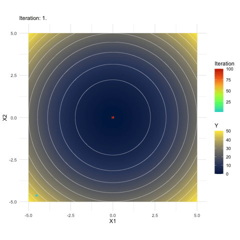
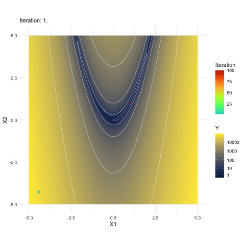
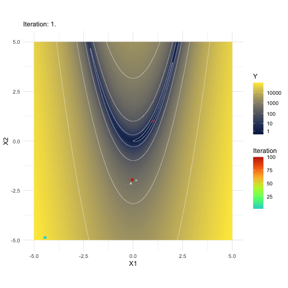
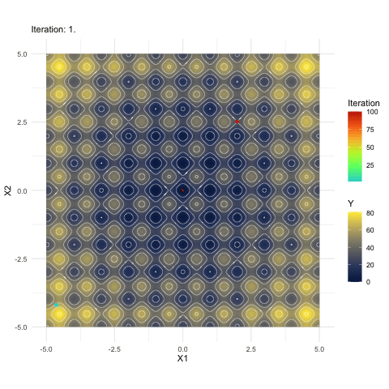
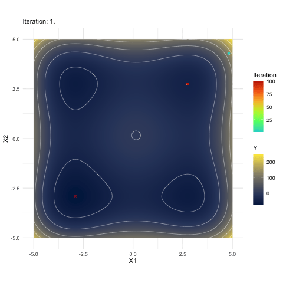
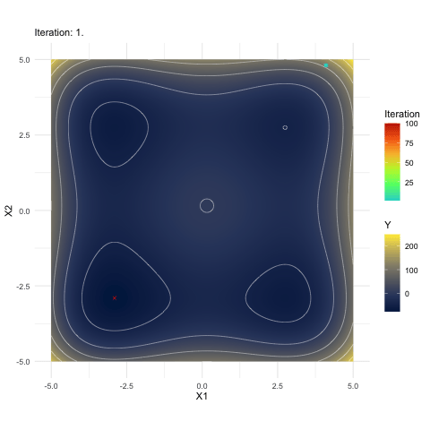
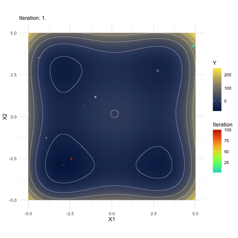

# Hons2025-Project
Honours Project Thesis Exploring Genetic Algorithms

This project contains a comparison of optimisation algorithms,
with a focus on Genetic Algorithms, with the goal to better understand 
how useful the 'evolution' metaphor is.

# Animated figures 

## Unimodal: Parabola

### Newton-Raphson with nu=0.5.

### Gradient descent with nu=0.2.

### Pure random search.

### Fixed step size random search with nu=0.2.

## Unimodal: Rosenbrock

### Newton-Raphson with nu=0.5.

### Gradient descent with nu=0.0001.

### Pure random search.

### Fixed step size random search with nu=0.2.

## Multimodal: Rastrigin

### Newton-Raphson with nu=0.5.

### Gradient descent with nu=0.2.

### Pure random search.

### Fixed step size random search with nu=0.2.

## Multimodal: Styblinski-Tang

### Newton-Raphson with nu=0.5.

### Gradient descent with nu=0.2.

### Pure random search.

### Fixed step size random search with nu=0.2.

