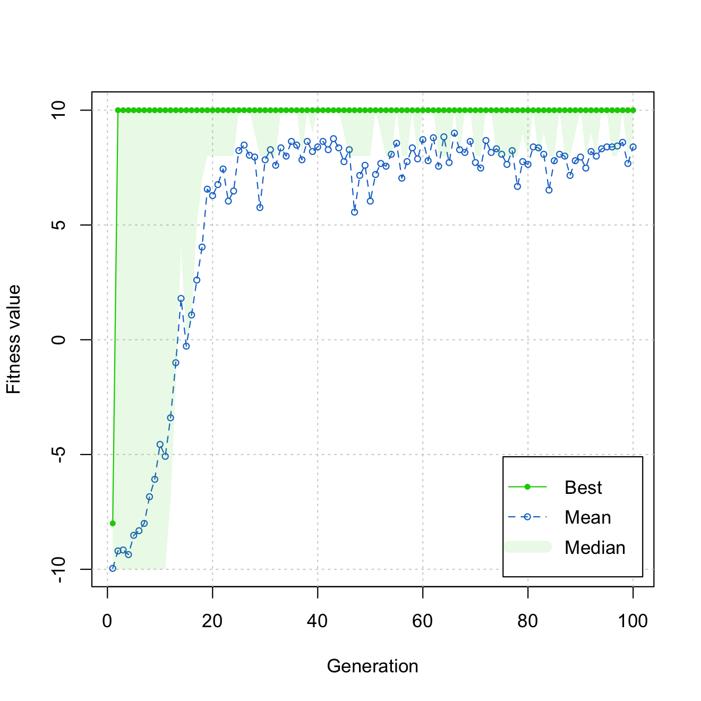

\tcbset{enhanced}
\newpage 

# Introduction

Optimisation can be thought of as a tool-selection problem -- with different optimisation paradigms being the tools in your toolbox. When dealing with a certain optimisation problem, the properties of the problem will inform which tools would perform best on it. Each tool would have their unique set of tradeoffs -- you *could* use a sledgehammer to nail together a wooden frame, and using a ball-peen hammer to take down a wall is certainly... possible, though it clearly would be more exhausting to tackle each of those problems in such a way.

When discussing optimisation algorithms (henceforth, "optimisers"), 'No Free Lunch' (NFL) theorems inform us that finding an optimiser that is _suited_ to a certain problem is how we realise the benefits of different optimisers: "any elevated performance over one class of problems is offset by performance over another class" [@wolpert1997].
Though, how would a poorly designed tool compare to a well-made one? How could such a thing fit into our broader NFL environment? Clearly a paper teaspoon would not be part of our greater toolbox of optimisers. We will explore how to evaluate inefficiencies or redundancy despite an understanding of NFL theorems.

Regarding optimisers, it is typical that those which make use of gradients perform better than those which use the problem's function value directly -- with methods making use of hessian information outperforming even those. Though it is important to note the limitations that both hessian and gradient methods (we can call these 'derivative' methods) do depend on being able to calculate or approximate gradients or hessians for the optimisation problem at hand.
It can also be noted that direct optimisers can have advantages over derivative methods. For optimisation problems where hessians and gradients can be found, there exists the possibility of them being harmful to an optimiser. These could be unstable to calculate, deceptive/misleading, or otherwise non-informative to an optimiser. Where this is not the case though, use of algorithms which can take advantage of gradients or hessians would be *expected* to be superior. 

For those cases where usage of either gradients or hessians are impossible or otherwise infeasible, direct methods are available. While this flexibility in which problems this type of optimiser can be applied to is beneficial, direct methods losing the information available from gradients or hessians would either have no effect or even a detrimental effect on an algorithm's performance in optimisation. It would not be useful to use such a method when ones better suited to a problem exist. For this reason direct methods like the genetic algorithm are most informatively compared with fellow direct methods. 
Therefore, this paper will primarily discuss the difference between genetic algorithms and their closest competitors: derivative-free optimisers, also known as black-box (or direct) methods.

The genetic algorithm (GA) is a pioneering algorithm in the space of nature-inspired optimisers---algorithms which look at processes in our natural world, and hope to capture what these natural processes can accomplish in the language of mathematics. It evokes incredibly powerful imagery, with Darwin's theory of natural selection, as well as our broader understanding of genetics. In fact, at first glance, the typical binary-coded genetic algorithm could easily be used as a standin for actual genetic code! If we pair off each 'digit' in our encoding, we could have a quaternary system that could represent the C, G, A, and T nucleobases of DNA directly. 
While quite exciting, the comparisons do end soon though, since genetic encodings do not typically go as far to replicate the double stranded nature of DNA, nor the fact that nucleobases must bind to each other in specific pairings (C & G, and A & T). It could be argued that GAs are instead replicating genetic information being stored in RNA rather than DNA. While it is theorised that this method of storing life's genetic information in RNA is possible and could perhaps have been the origins of life, no direct evidence of this remains, and the natural world as we know it does not itself function in such a manner. 

# Literature Review

The early descriptions of GAs as popularised by @holland1975 had parameters represented in bits, i.e., binary-coded GAs.

The development of the real-coded genetic algorithm (RCGA) came as a result of challenges that came with binary-coded genetic algorithms.

RCGAs typically require a set of bounds -- upper and lower bounds which we sample within (etcetc) -- over which to optimise (they are search algorithms). If we use an random search (RS) method, we can do much the same.

Eventually came GA's application to multiobjective optimisation, since issues with constraint satisfaction had been remedied, and GAs showed a promising ability to take to high-dimensional problems.

By the end of the 20th century, GA had already become viewed as a powerful tool for both discrete and continuous optimisation.

Currently much focus has been placed on 'hybrid' algorithms. Algorithms which do not solely use GA: adding other algorithms to capture the global exploration benefits GA might offer, but with local search capabilities of other algorithms [@chaudhary2026]. 

The forefront of RCGA development has been on finding and designing crossover & mutation methods which lend themselves to performing well with the continuous nature of the parameters.

How much can we change an algorithm before it ceases to be what it promised to be? The changes in these algorithms could now place them in a significantly different sphere than originally.

We will look into some of the simpler crossover and mutation methods later in this paper. Comparison to the newer adaptive methods of crossover and mutation will show that GAs have become something entirely different to what the metaphors had once started with.

The NFL theorems might be taken to tell us that every algorithm is valuable, since any dip in performance in any set of problems, is countered by the performance an algorithm has in the complement of that set. While we might argue that the usefulness of all problems in the universal set is not equal -- that their applicability to real world problems is not uniformly weighted -- even if we accept this without scrutiny, we still have avenues to argue that indeed not all algorithms are equally valuable. 

The NFL theorems necessitate that an algorithm does not return to previous points. 
This might seem like it immediately disqualifies most methods -- or is practically infeasible -- but any algorithm can be made to meet this requirement. Simply by storing the inputs and outputs (fitness value) to every objective function (fitness function) call, we meet the requirements to apply NFL. If before we call the objective function, we search if that combination of inputs has already been evaluated, and only then call the objective function if it has not -- using   the fitness value we previously stored in the case of a repeated call. This can ensure that we never evaluate the objective function at the same point more than once.
Now this does add overhead, which may become significant, especially where objective function calls are cheap. But where objective function calls become complex and expensive, it is often worth the memory and processor usage.

It should be easy to imagine an algorithm that could be considered especially ineffective. Though it is important to note that NFL theorems also seem to require that an algorithm is _capable_ of visiting all points, so our simplest ideas (some algorithm that repeatedly searches a single point or small set of points) for something ineffective will not actually fit. 
We could find a fitting candidate for our ineffective algorithm if we imagine an algorithm that often repeats the points it has previously visited: perhaps as the amount of points it has visited increases, it finds itself more and more likely to repeat points instead of finding a new point. Perhaps it visits each order combination of previously visited points before searching a new point -- thus having $O(n!)$ complexity! 
We can compare this to a related algorithm that skips the repeated evaluations and instead directly searches the exact same new points without these artificial inefficiencies. These two algorithms would now, having applied the aforementioned method to make any algorithm NFL theorem compatible, the exact same signature. The precisely same order of function evaluations. Yet clearly, these algorithms have nowhere near the same value, even if viewed as the same in NFL theorems. 
Of course, this is not a fair argument against NFL. But with this extreme argument, it can be shown that there definitively is the ability for some algorithms to be better or worse to apply to the problem of optimisation. Certainly, there exists No Free Lunch, but there certainly _can_ exist an overpriced lunch.

We now have an avenue of criticism for our algorithms: whether the overhead of our optimisation method renders it unproductive.

Considering the scepticism into nature-inspired methods in the last decade, it is only natural to scrutinise one of the foremost pillars in nature-inspired methods with the same inspecting light that newer methods have been cast in. While the influx of nature-inspired methods has been cause for concern for the entire field of metaheuristics [@aranha2021], the RCGA has been left mostly unscathed. Let us explore how much of that is due to their inherent performance, and how much may be due to their proximity to the performance GAs more broadly.

# Design
 
## Update procedures

Where noted, a *strictly improving update procedure* will be used alongside the updating equations, defined as: $$\B x_{k+1} = \begin{cases}\B v_{k+1}&\text{if} \quad \op{f}{\B v_{k+1}}< \op{f}{\B x_k},\\\B x_k & \text{otherwise.}\end{cases}$$ Where $\B x_k$ is the best performing point at iteration $k$, and $\B v_{k+1}$ is the candidate point for the next iteration, $k+1$. This candidate point is generated by the **updating equation**.

Alternatively, the update procedure could be a simpler, *direct updating procedure*, where every updated point, $\B v_{k+1}$, is taken as the next iteration (thus the algorithm remains the same, but every $\B x_k$ in the above formula is replaced with $\B v_k$). No comparison with previous points is done. This would likely fit the deterministic algorithms better. The best solution at point $k$, $\B x_k$, is stored separately as a vector -- never accessed by the algorithm.

## Updating equations

At the core of this exploration of genetic algorithms and other methods for optimisation, are the *updating equations*. These define how each optimisation paradigm attempts to iteratively improve a candidate solution, $\B v$.

### Hessian methods

Methods which utilise exact or approximate hessians.

#### Newton-Raphson

Calculates the hessian. $$\B x_{k+1} = \B v_k -\frac{f'\left(\B v_k\right)}{f''\left(\B v_k\right)}$$

### Gradient methods

Methods which utlise exact or approximate gradients.

#### Gradient descent

$$\B v_{k+1} = \B v_k -\nu \nabla f\left( \B v_k \right),$$ where $\nu$ is the learning rate.

### Direct search methods

Also known as pattern search or black-box methods. These algorithms do not make use of gradient nor of hessian information. This makes them far easier to apply to any context.

#### Random search (RS)

The specific version of the random search algorithm is informed by the descriptions given in @zabinsky2011. Algorithms are described by being 'global' or 'local'.

**Pure Random Search (PRS)** repeatedly performs a global search with a simply improving update procedure.

The updating equation is defined as, $$\B v_{k+1} = \B u.$$

It is notable that neither of the terms $\B x_k$ nor $\B v_k$ -- the best or candidate points found by or for iteration $k$ -- are present in this formula.

Each generated point is *independent* of any previous point. The major benefit of this is PRS is 'embarrassingly parallelisable'. This is the only optimisation algorithm that will have this property in this paper.

We also test an additional variant of RS, where a global search is performed solely for the starting point, $\B x_0$, or skipped entirely in favour of a user-defined starting point. Subsequent points are generated locally from the hypersphere (referred to as the '$\left(N-1\right)$-sphere', or 'surface of the $N$-ball') around $\B x_k$.

This is Rastrigin's **Fixed Step Size Random Search (FSSRS)**[@rastrigin1963]. Rastrigin is also credited with coining the term 'random search', though the name FSSRS is a term given by others to distinguish this original form of RS from other optimisers.

An efficient way to sample uniformly from the surface of an $N$-ball is given by @marsaglia1972.

$$\B v_{k+1} = \B x_k +h \B u.$$

Here, $\B u$ is a normalised $N$-dimensional vector sample from the standard normal distribution such that,

$\B u = \frac1{\lVert \B z \rVert}\B z$ and $\B z \sim \mathcal{N}_N\left(0,1\right),$ and where $h$ is a step size hyperparameter.

# Genetic algorithms: the GA package

Genetic algorithms are a subset of evolutionary algorithms, typified by the use of three genetic operators: two-parent **crossover**, fitness-based **selection**, and random **mutation**.

*Real-coded* (in reference to $\mathbb R$, the real number set) genetic algorithms are used in this paper for greater applicability to arbitrary problems and models -- despite genetic processes occurring with a discrete set of genes (ACGT) in nature.

Notation does shift here, due to the genetic algorithm necessarily requiring multiple candidates for each iteration. Our previous notation referencing a single candidate per iteration is thus no longer feasible.

We are implementing genetic algorithms using the `GA` package, as described in @scrucca2013.

A brief explanation of the updating procedure follows.

## **Fitness evaluation**

Fitness for each of the candidate solutions ('genotypes'), $\theta_i^{\left(k\right)}$ is calculated, where $i$ is an arbitrary index of the candidate solution in the generation $k$. This is typically the objective function of interest, $\op f{\cdot}$.

## Genetic Operators

### **Selection**

A subset of candidate solutions from the current generation's population becomes selected as a separate population known as the 'reproducing population'. Solutions are selected (with replacement) through a weighted selection process, based typically proportionally on the fitness of each genotype, $\op{f\!}{\theta_i^{\left(k\right)}}$, with probability $p_i^{\left(k\right)}$.

An elitist strategy can be used, which means that even if the best performers are unluckily not selected, an amount of them are still are pushed through to the next population. The default method for real-valued parameters is `gareal_lsSelection`: proportional selection with fitness linear scaling.

\begin{tcolorbox}[title=Selection with linear scaling: \texttt{gareal\_lsSelection()}]
Let $\B f$ contain the fitness values of each member in the current population.\\
\\
To ensure all fitness values are positive:
$$
\B f \leftarrow \begin{cases}
\B f- \op{min}{\B f} & \text{if } \op{min}{\B f} < 0,\\
\B f & \text{otherwise.}
\end{cases}
$$
Then, $\B f$ is scaled as follows.\\
\\
Let the mid-range, $M=\frac{\op{min}{\B f} +\op{max}{\B f}}2$.

$$
\begin{aligned}
\delta &=
\begin{cases}
\op{max}{\B f} - \bar f 
& \text{if } \bar f > M,
\\
\bar f -\op{min}{\B f} 
& \text{otherwise,}
\\
\end{cases}
\\
a&= 
\frac{\bar f}{\delta} \\
b&= 
\frac{\bar f}{\delta}\left(\delta - \bar f\right) = \bar f(1-\frac{\bar f}{\delta})
\end{aligned}
$$
$\B f' = a\B f + b$.\\
\\
The probabilities for sampling with replacement are calculated from the scaled fitness values, $\B f'$, where:
$$ p_i = \frac{f'_i}{\sum_j^Nf'_j}.$$

\end{tcolorbox}
Note that this is not the exact algorithm as contained within Scrucca's GA package. I have taken the liberty to simplify and rearrange terms for clarity of analysis. 

### **Crossover**

The core of a genetic algorithm, the crossover operation, brings a means to generate 'child' (next generation) solutions through use of the 'genetic information' (parameter values) from either of the 'parent' (current generation) solutions. Alongside mutation, crossover applied on the reproducing population creates the new, next generation population. The default method for real-valued parameters is `gareal_laCrossover`: local arithmetic crossover.
These functions take two 'parent' solutions and generate two 'child' solutions.

Before any crossover algorithm is applied, a preprocessing step is done to pair solutions into 'mating' pairs.

Where $N$ is the population size, and $n_p$ is the number of parents selected for crossover.
$$
\begin{aligned}
n_p &= 2\lfloor \frac{N}2\rfloor ,
\\
\B\theta^k_1, \dots, \B\theta^k_{n_p}  &\in_R \Theta^k,
\end{aligned}
$$
such that each candidate solution $\B\theta_i$ is selected uniformly randomly without replacement from $\Theta^k$, and organised into pairs for the crossover algorithm.

After the selection phase, solutions from the population are randomly split into pairs. These will serve as the parents from which a pair of child solutions will be calculated.

\begin{tcolorbox}[title=Local arithmetic crossover: \texttt{gareal\_laCrossover()}]
Where $\B a$ is a vector of standard uniform deviates.
$$
\begin{aligned}
\B a &\sim \mathcal U\!\left(0,1\right)\\
\B\theta_1^{k+1} &= \B a \circ \B\theta_1^k +\left(1-\B a\right)\circ\B\theta_2^k \\
\B\theta_2^{k+1} &= \B a \circ \B\theta_2^k +\left(1-\B a\right)\circ\B\theta_1^k
\end{aligned}
$$
A pair of child solutions, $\B\theta_1^{k+1}$, $\B\theta_2^{k+1}$, are calculated as weighted mean of the parents' parameter values. For each pair of parent solutions, $\B\theta^k_1$, $\B\theta^k_2$, the weighting, $\B a$, is a vector of size $p$ of random deviates from a standard uniform distribution. Each child is calculated as one of the combinations of parent solutions.\\

This process is performed for each pair of parent candidate solutions.
\end{tcolorbox}

This is a simple crossover paradigm. While it is _the default_ method applied to real-coded parameters, we do not want to risk strawmanning GAs in this analysis. Since crossover sits at the core of a GA's ability to explore a parameter space, if a method of crossover is not able to do so well, it will easily kneecap the entire algorithm as a whole. 
To account for this, we shall also take a look at the other real-coded crossover methods found in the GA package. 
While not a comprehensive look at everything GAs have to offer, we are able to look at the convenient tools most analysts would be reaching for. This feels more appropriate to ensure meaningful results and discussion can come from this analysis. 

Within the GA package, we see that the crossover methods are:
\begin{itemize}
  \item[{[default]}] \verb|gareal_laCrossover|: local arithmetic crossover,
  \item[--] \verb|gareal_waCrossover|: whole arithmetic crossover,
  \item[--] \verb|gareal_blxCrossover|: blend crossover,
  \item[--] \verb|gareal_laplaceCrossover|: laplace crossover,
  \item[{[missing]}]\verb|gareal_spCrossover|: single-point crossover,
  \item[{[missing]}]\verb|gareal_uCrossover|: uniform crossover.
\end{itemize}

*There are two additional methods mentioned in @scrucca2013 which appear not to be present in the codebase.

\begin{tcolorbox}[title=Whole arithmetic crossover: \texttt{gareal\_waCrossover()}]
Similar to local arithmetic crossover, but where $a$ is a shared single value for all parameters rather than a vector of standard uniform values.

$$
\begin{aligned}
a &\sim \mathcal U\!\left(0,1\right)\\
\B\theta_1^{k+1} &= a \B\theta_1^k +\left(1-a\right)\B\theta_2^k \\
\B\theta_2^{k+1} &= a \B\theta_2^k +\left(1-a\right)\B\theta_1^k
\end{aligned}
$$
A pair of child solutions, $\B\theta_1^{k+1}$, $\B\theta_2^{k+1}$, are calculated as weighted mean of the parents' parameter values. For each pair of parent solutions, $\B\theta^k_1$, $\B\theta^k_2$, the weighting is random value, $a$, from a standard uniform distribution. Each child is calculated as one of the combinations of parent solutions.\\

This process is performed for each pair of parent candidate solutions.
\end{tcolorbox}

\begin{tcolorbox}[title=Blend crossover: \texttt{gareal\_blxCrossover()}]
With a blend parameter $a$ that defaults to $0.5$.
\\

For a pair of parent candidate solutions, $\B\theta_1$ and $\B\theta_2$, each with $p$ parameters, and for each pair of corresponding parameters, $\theta_{1j}$ and $\theta_{2j}$, within those candidate solutions, the following is applied.

$$
\begin{aligned}
x_1 &= \op\min{\theta_{1j}, \theta_{2j}}, \\
x_2 &= \op\max{\theta_{1j}, \theta_{2j}}, \\
\\
b_j &= x_1 - a\left(x_2-x_1\right), \\
c_j &= x_2 + a\left(x_2-x_1\right), \\
\\
b_j &\leftarrow 
\begin{cases}
b_j &\text{if } b_j>\text{min}_j,\\
\text{min}_j &\text{otherwise},
\end{cases}\\
c_j &\leftarrow 
\begin{cases}
c_j &\text{if } c_j<\text{max}_j,\\
\text{max}_j &\text{otherwise},
\end{cases} \\
\\
u_1,u_2 &\sim \mathcal U \!\left(b_j,c_j\right),\\
\theta_{1j} &\leftarrow u_1,\\
\theta_{2j} &\leftarrow u_2,\\
\end{aligned}
$$
for all $j$ in $\left\{1, \dots, p\right\}$.\\

This process is performed for each pair of parent candidate solutions.
\end{tcolorbox}

\begin{tcolorbox}[title=Laplace crossover: \texttt{gareal\_laplaceCrossover()}]
Scrucca references @deep2009 for the recommendation of $a=0$ and $b=0.15$ for the location and scale parameters to be used with the Laplace distribution for the case of real-coded genetic algorithms.

These are the default values for this method, though overwritable when called.

$$
\begin{aligned}
r_j,u_j &\sim \op{\mathcal U}{0,1},\\
\beta_j &= \begin{cases}
a+b\log\left(u_j\right) & \text{if } r_j > 0.5, \\
a-b\log\left(u_j\right) & \text{otherwise},
\end{cases}\\
\\
s_j &= \beta_j \lvert \theta_{1j} - \theta_{2j} \rvert, \\
\\
t_{1j} &= \theta_{1j} + s_j,\\
t_{2j} &= \theta_{2j} + s_j, \\
\\
\theta_{1j} &\leftarrow 
\begin{cases}
\min_j & \text{if } t_{1j} \leq \min_j,\\
t_{1j} & \text{if } \min_j < t_{1j} < \max_j,\\
\max_j & \text{otherwise},\\
\end{cases}\\
\theta_{2j} &\leftarrow
\begin{cases}
\min_j & \text{if } t_{2j} \leq \min_j,\\
t_{2j} & \text{if } \min_j < t_{2j} < \max_j,\\
\max_j & \text{otherwise},\\
\end{cases}
\end{aligned}
$$
for all $j$ in $\left\{1, \dots, p\right\}$.\\

This process is performed for each pair of parent candidate solutions.
\end{tcolorbox}

Notably, Laplace crossover is the only method which does not have the issue of its child parameter value being constrained to the range given by its parent values.

It is clear that nearly regardless of the method chosen for crossover, the outcome is quite similar. The parameter value of the child will be limited in scope to the values given by the parents. This necessarily means that diversity in the solution space will gradually dwindle as the algorithm progresses. This lack of diversity will ensure the algorithm is less and further less able to better the fitness value as the population homogenises, due to not being able to effectively explore the solution space.

To combat this -- other than avoiding the use of crossover methods with are not the Laplace method provided -- we can allow for mutation to help disturb our settling into any part of the solution space, and allow us to increase diversity.

Essentially regularisation! We are turning the mutation operators into random search!

Population staging

### **Mutation**

The randomly shifting of the values of 'genes' (parameters) within genotypes. The probability of mutation can be set by the user. Alongside crossover, mutation applied on the reproducing population creates the new, next generation population. By default, `gareal_raMutation` is used, which is uniform random mutation.

\begin{tcolorbox}[title=Uniform random mutation: \texttt{gareal\_raMutation()}]
Generates a uniform random deviate for one randomly selected parameter value, constrained on the bounds for that specific parameter.\\
\\
The new mutated value is completely unaffected by whatever value the original parameter held.

$$\theta_j \in_R \B \theta$$
$$x\sim \mathcal U \! \left( \text{min}_j, \text{max}_j \right)$$
$$\B \theta _j \leftarrow x$$
\end{tcolorbox}

Crossover and mutation operations intend to increase diversity in a population, allowing us to explore more of the sample space (exploration), while selection operations decrease diversity in favour of increased fitness (exploitation).

# Methodology

# Arbitrary Objectives: a Drone Game!

Parameters -> 5,5-Neural network -> trained with GA -> Drone Game

# Analysis

We will now look at the behaviour of each optimiser by looking at the traces they leave when tested for 100 steps on a 2-dimensional parabolic test surface. This is a very basic test surface, but it will help us orient ourselves with a basic understanding of each of these optimisers' typical behaviour patterns. Additionally, above the traces, a line graph of the performance over the iterations for each optimiser is shown for simpler comparison.

The coloured dots show the progression of the best point found by each optimiser.
White crosses show each function evaluation by the optimiser. These will often be obscured by the coloured dots, unless the optimiser fails to better the optimal location in a step by large enough margin to be visible. 

The following traces are also viewable as an animation! These are accessible in \href{https://github.com/m-yday/Hons2025-Project}{the Github repository for this project}.

To give a point of comparison, we'll also take a look at the behaviour of the Newton-Raphson & gradient descent optimisers.

{#fig-newt-raph height="160mm"}

{#fig-grad-desc height="160mm"}

Our hessian- and gradient-based optimisers have both performed extremely well, as expected! Their traces are quite indistinguishable from one another. Without any penalisation values, $\nu$, Newton-Raphson did outperform gradient descent by reaching the centre in just a few steps. But after choosing penalisation values for each optimiser, as shown above in @fig-newt-raph and @fig-grad-desc, we end up with very similar results. Both methods move directly towards the minimum point at $\left(0, 0\right)$ immediately, their step sizes decreasing as the slope decreases. This is of course a problem extremely well-suited to such hessian- and gradient-based methods.

{#fig-pure-rs height="160mm"}

@fig-pure-rs showcases just how lucky PRS can really be. The performance plot shows a curve quite reminiscent of that from the Newton-Raphson and gradient descent optimisers. Though the reality is that this performance was simply lucky. PRS could easily have found its best performing solution at iteration 45, or 86, or 93. Paying close attention, the best candidate solution was found on approximately the 18th iteration of the algorithm. While that sounds very optimistic, it also means the algorithm had run for approximately 82 iterations with no improvement. The fact that it got so lucky on the 18th iteration would not be something you could rely on over multiple runs, or multiple different problems. This issue only gets worse as a problem's dimensions increase. While PRS does have a uniform probability to reach any point in the search space, and does not have the issue of getting 'stuck' in local optima, there is no guarantee of improvement as the algorithm runs. Improvements in this algorithm are proportional to the performance of the best point currently found:
Let the comprehensive set of possible solutions in the search space be $U$. We can collect all possible solutions which perform better than the best solution found by the optimiser at iteration $k$, $x_k$, into a set, $S$. and $S$ takes up 5% of $U$ then there is only a probability of 5% that the candidate solution $v_{k+1}$ has better performance than $x_k$.

This can help us identify another place where performance of PRS might suffer or improve. Even certain properties of PRS. The distribution of performance for the possible solutions in a specific problem changes, so too does the effectiveness of optimisers like PRS. Since PRS is uniformly able to select any point in the solution space, we theoretically could 'rank' all possible points by their performance. This would let us obtain for any problem a curve of the performance values by percentile. And knowing how improvement is proportional to the (complement of the) performance percentile of a problem, we could take an expected value or confidence interval for what percentile we could expect to receive after $k$ iterations.

<-talk about clustering?->

If the 80th percentile of performance does about as well as the 20th, that ranking improvement, which encompasses 60% of the entire population, is meaningless if that 60% improvement takes too many additional iterations. 

{#fig-rand-sear height="160mm"}

## Measuring Performance

An interesting issue with drawing comparisons between GAs and optimisation procedures is the issue of fairly assessing the amount of function calls. We could simply compare the iteration number like we have with the other optimisation procedures. We would have to note how some procedures require more overhead for each function call, but until now, these overheads above the function call were not too excessive. Now with GAs, we have an entire population being assessed with each iteration. The GA package (Scrucca 2017) uses a default population size of 50, and throws a warning if the population size is less than 10. 

A solution to this is taking the product of the iteration number and population size to get a value of function calls completed by the process. This does seem to be the fairest assessment method. When attempting this, we might use the iteration limit of 100 that we have currently been using, and divide that by the population size being used.

Whoops. Using the default value, we've reached our maximum amount of function calls in two population iterations.

Clearly, we have not given GAs a fair chance to flex their muscles. There has barely been enough time for any of the 'learning' that GAs are capable of to come through in a single step.

So perhaps we try a more balanced value: 10 iterations of population size 10. 

Ah phooey. We now have the issue of rarer events like mutation $\left(p=0.1\right)$ only occurring once on average per population step. Additionally, 10 population steps is still squeezing the algorithm quite a bit. This seems hardly fair. Random search will have trouble making any meaningful progress towards a solution if it was given 10 iterations. Even gradient methods would have the issue of having suboptimal results with 10 iterations. Therefore, this is clearly not an issue that lands solely with direct search methods.

Perhaps we could consider _unique_ function calls. This may be a better fit. GAs do have a tendency to repeatedly check the same values. Well-performing genes will survive to the next generation, to be tested again. Crossover does complicate this, but it should be clear that in principle, the probability of collisions is increased through this form of performance sampling. Though this does diminish quickly as the dimensions of the search increase. 

{#fig-ga-perf width="100mm"}

Wow! Clearly GAs do a pretty fine job. In just 2 population steps we had already had at least one full set of 10 drones successfully completing the course. 
Additionally by iteration 25, even the mean score of the drones is comfortably sitting at ~8. Noting that minimum score possible is -10, and maximum is 10, that means we consistently have 9/10 drones completing the course. 

So why have I been so negative toward GA, when its performance looks so promising? 

Well, let's consider some things that these graphs are not showing.
2 steps means between 51-100 function calls, the GA was able to eventually gain its first completely successful run. This is not completely bogus, it's a very fair result from a direct search algorithm. This is a comfortable position to be in relation to RS.

This took approximately $xyz$ seconds to run. In comparison, a local random search algorithm takes $zyx$ seconds. This is a $abc$-fold increase over other methods.
When we compare the performance of the RS training of the neural network, we find that: 

Even if we stop the training after 25 population iterations, that is still 1250 function calls.

# Results

# Conclusion

<!--## Areas for extension

aka, how i don't go down too many rabbit holes while working on this

 Testing additional random search algorithms: - Luus–Jaakola (LJ) - Improving Hit-and-Run (IHR) - Simulated Annealing

Testing against Travelling Salesman Problem (or problems where the search space grows rapidly)

mention: metaheuristics converging iterative / single step / (what word was it) optimisation

Show probability of collisions with GAs (crossover) -->

\newpage

# Bibliography

::: {#refs}
:::