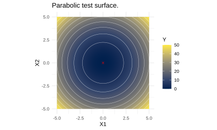
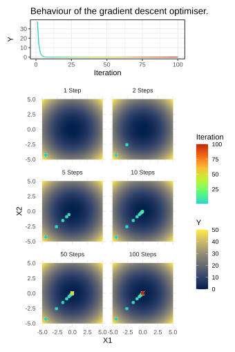
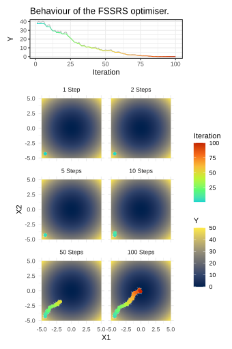
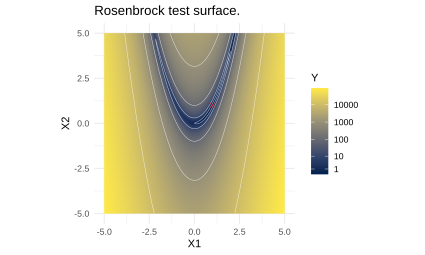
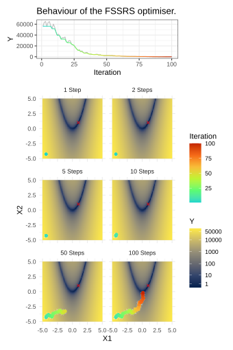
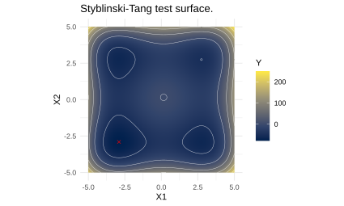

\tcbset{enhanced}
\newpage 

# Introduction

Optimisation can be thought of as a tool-selection problem -- with different optimisation paradigms being the tools in your toolbox. When dealing with a certain optimisation problem, the properties of the problem will inform which tools would perform best on it. Each tool would have their unique set of tradeoffs. Indeed, careful consideration of the tradeoffs, over time have led to strong association between particular optimisation routines and statistical model classes, such as gradient descent being associated with backpropagation with neural networks; iteratively reweighted least squares for generalised linear models; and the A* algorithm for shortest-path graph traversal. 

For optimisation algorithms (henceforth, "optimisers"), it is typical that those which make use of gradients perform better than those which use the problem's function value directly -- with methods making use of Hessian information outperforming even those. Though it is important to note the limitations that both Hessian and gradient routines (we can call these 'derivative' routines) do depend on being able to calculate or approximate gradients or Hessians for the optimisation problem at hand. 
It can also be noted that direct optimisers can have advantages over derivative routines. For optimisation problems where Hessians and gradients can be found, there exists the possibility of them being harmful to an optimiser. These could be unstable to calculate, deceptive/misleading, or otherwise non-informative to an optimiser. Where this is not the case though, use of algorithms which can take advantage of gradients or Hessians would be *expected* to be superior. 

For those cases where usage of either gradients or Hessians are impossible or otherwise infeasible, direct routines are what remain available. This ability to forego derivative calculations is of _major_ benefit. For non-differentiable objectives, derivative-free routines like the genetic algorithm are the only option -- and if we are to compare optimisers, GAs are most informatively compared with fellow direct routines. 
Therefore, this paper will primarily discuss the difference between genetic algorithms and their closest competitors: derivative-free optimisers, also known as black-box (or direct) methods. This thesis compares GAs with random search methods. Newton-Raphson and gradient descent are included only as reference points.

The genetic algorithm (GA) is a useful class of optimisation routines which are inspired by genetic processes in biology. Currently, there are many optimisation routines in this space of nature-inspired optimisers -- routines which look at processes in our natural world, and hope to capture what these natural processes can accomplish in the language of mathematics. It evokes incredibly powerful imagery, with Darwin's theory of natural selection, as well as our broader understanding of genetics. However, the resemblance to biology is limited.

In fact, at first glance, the typical binary-coded genetic algorithm could easily be used as a standin for actual genetic code! If we pair off each 'digit' in our encoding, we could have a quaternary system that could represent the C, G, A, and T nucleobases of DNA directly.
While quite exciting, the comparisons do end soon though, since genetic encodings do not typically go as far to replicate the double stranded nature of DNA, nor the fact that nucleobases must bind to each other in specific pairings (C & G, and A & T). It could be argued that GAs are instead replicating genetic information being stored in RNA rather than DNA. While it is theorised that this method of storing life's genetic information in RNA is possible and could perhaps have been the origins of life, no direct evidence of this remains, and the natural world as we know it does not itself function in such a manner. 

The rapid growth of nature-inspired methods has raised concern across the field of metaheuristics (Aranha et al., 2021). It could be observed that the real-coded genetic algorithm (RCGA) has largely avoided this criticism. This thesis examines whether that position is deserved. 

Although these methods are powerful and find application in numerous sub-disciplines of statistics and machine learning, the particular application to finding estimates of real-valued parameter vectors stretches the metaphor quite a bit. In the present paper, we attempt to answer the question

1) IS GA for continuous parameter search just random search (Monte-Carlo Search) in disguise?
2) What advantages, if any, do RCGAs provide over brute force random search?

Section 2 reviews the development of GAs and addresses No Free Lunch theorems. Section 3 defines the optimisers. Section 4 describes the genetic operators in the GA package (@scrucca2013). Section 5 sets out the methodology. Section 6 applies each optimiser to four test surfaces. Sections 7 and 8 present the results and conclusions.

\newpage

# Literature Review

The early descriptions of GAs as popularised by @holland1975 had parameters represented in bits, i.e., binary-coded GAs.

The development of the real-coded genetic algorithm (RCGA) came as a result of challenges that came with binary-coded genetic algorithms.

RCGAs typically require a set of bounds -- upper and lower bounds -- for each variable over which to optimise. If we use an random search (RS) method, we can do much the same.

Eventually came GA's application to multiobjective optimisation, since issues with constraint satisfaction had been remedied, and GAs showed a promising ability to take to high-dimensional problems.

By the end of the 20th century, GA had already become viewed as a powerful tool for both discrete and continuous optimisation.

Currently much focus has been placed on 'hybrid' algorithms. Algorithms which do not solely use GA: adding other algorithms to capture the global exploration benefits GA might offer, but with local search capabilities of other algorithms [@chaudhary2026]. 

The forefront of RCGA development has been on finding and designing crossover & mutation methods which lend themselves to performing well with the continuous nature of the parameters.

How much can we change an algorithm before it ceases to be what it promised to be? The changes in these algorithms could now place them in a significantly different sphere than originally.

We will look into some of the simpler crossover and mutation methods later in this paper. Comparison to the newer adaptive methods of crossover and mutation will show that GAs have become something entirely different to what the metaphors had once started with.

The NFL theorems might be taken to tell us that every algorithm is valuable, since any dip in performance in any set of problems, is countered by the performance an algorithm has in the complement of that set. While we might argue that the usefulness of all problems in the universal set is not equal -- that their applicability to real world problems is not uniformly weighted -- even if we accept this without scrutiny, we still have avenues to argue that indeed not all algorithms are equally valuable. 

The NFL theorems necessitate that an algorithm does not return to previous points. 
This might seem like it immediately disqualifies most methods -- or is practically infeasible -- but any algorithm can be made to meet this requirement. Simply by storing the inputs and outputs (fitness value) to every objective function (fitness function) call, we meet the requirements to apply NFL. If before we call the objective function, we search if that combination of inputs has already been evaluated, and only then call the objective function if it has not -- using   the fitness value we previously stored in the case of a repeated call. This can ensure that we never evaluate the objective function at the same point more than once.
Now this does add overhead, which may become significant, especially where objective function calls are cheap. But where objective function calls become complex and expensive, it is often worth the memory and processor usage.

It should be easy to imagine an algorithm that could be considered especially ineffective. Though it is important to note that NFL theorems also seem to require that an algorithm is _capable_ of visiting all points, so our simplest ideas (some algorithm that repeatedly searches a single point or small set of points) for something ineffective will not actually fit. 
We could find a fitting candidate for our ineffective algorithm if we imagine an algorithm that often repeats the points it has previously visited: perhaps as the amount of points it has visited increases, it finds itself more and more likely to repeat points instead of finding a new point. Perhaps it visits each order combination of previously visited points before searching a new point -- thus having $O(n!)$ complexity! 
We can compare this to a related algorithm that skips the repeated evaluations and instead directly searches the exact same new points without these artificial inefficiencies. These two algorithms would now, having applied the aforementioned method to make any algorithm NFL theorem compatible, the exact same signature. The precisely same order of function evaluations. Yet clearly, these algorithms have nowhere near the same value, even if viewed as the same in NFL theorems. 
Of course, this is not a fair argument against NFL. But with this extreme argument, it can be shown that there definitively is the ability for some algorithms to be better or worse to apply to the problem of optimisation. Certainly, there exists No Free Lunch, but there certainly _can_ exist an overpriced lunch.

We now have an avenue of criticism for our algorithms: whether the overhead of our optimisation method renders it unproductive.

Considering the scepticism into nature-inspired methods in the last decade, it is only natural to scrutinise one of the foremost pillars in nature-inspired methods with the same inspecting light that newer methods have been cast in. While the influx of nature-inspired methods has been cause for concern for the entire field of metaheuristics [@aranha2021], the RCGA has been left mostly unscathed. Let us explore how much of that is due to their inherent performance, and how much may be due to their proximity to the performance GAs more broadly.

\newpage

# Design
 
## Update procedures

Where noted, a *strictly improving update procedure* will be used alongside the updating equations, defined as: $$\B x_{k+1} = \begin{cases}\B v_{k+1}&\text{if} \quad \op{f}{\B v_{k+1}}< \op{f}{\B x_k},\\\B x_k & \text{otherwise.}\end{cases}$$ Where $\B x_k$ is the best performing point at iteration $k$, and $\B v_{k+1}$ is the candidate point for the next iteration, $k+1$. This candidate point is generated by the **updating equation**.

Alternatively, the update procedure could be a simpler, *direct updating procedure*, where every updated point, $\B v_{k+1}$, is taken as the next iteration (thus the algorithm remains the same, but every $\B x_k$ in the above formula is replaced with $\B v_k$). No comparison with previous points is done. This would likely fit the deterministic algorithms better. The best solution at point $k$, $\B x_k$, is stored separately as a vector -- never accessed by the algorithm.

## Updating equations

At the core of this exploration of genetic algorithms and other methods for optimisation, are the *updating equations*. These define how each optimisation paradigm attempts to iteratively improve a candidate solution, $\B v$.

### Hessian methods

Methods which utilise exact or approximate Hessians.

#### Newton-Raphson

Calculates the Hessian. $$\B x_{k+1} = \B v_k -\frac{f'\left(\B v_k\right)}{f''\left(\B v_k\right)}$$

### Gradient methods

Methods which utilise exact or approximate gradients.

#### Gradient descent

$$\B v_{k+1} = \B v_k -\nu \nabla f\left( \B v_k \right),$$ where $\nu$ is the learning rate.

### Direct search methods

Also known as pattern search or black-box methods. These algorithms do not make use of gradient nor of Hessian information. This makes them far easier to apply to any context.

#### Random search (RS)

The specific version of the random search algorithm is informed by the descriptions given in @zabinsky2011. Algorithms are described by being 'global' or 'local'.

**Pure Random Search (PRS)** repeatedly performs a global search with a simply improving update procedure.

The updating equation is defined as, $$\B v_{k+1} = \B u.$$

It is notable that neither of the terms $\B x_k$ nor $\B v_k$ -- the best or candidate points found by or for iteration $k$ -- are present in this formula.

Each generated point is *independent* of any previous point. The major benefit of this is PRS is 'embarrassingly parallelisable'. This is the only optimisation algorithm that will have this property in this paper.

We also test an additional variant of RS, where a global search is performed solely for the starting point, $\B x_0$, or skipped entirely in favour of a user-defined starting point. Subsequent points are generated locally from the hypersphere (referred to as the '$\left(N-1\right)$-sphere', or 'surface of the $N$-ball') around $\B x_k$.

This is Rastrigin's **Fixed Step Size Random Search (FSSRS)**[@rastrigin1963]. Rastrigin is also credited with coining the term 'random search', though the name FSSRS is a term given by others to distinguish this original form of RS from other optimisers.

An efficient way to sample uniformly from the surface of an $N$-ball is given by @marsaglia1972.

$$\B v_{k+1} = \B x_k +\nu \B u.$$

Here, $\B u$ is a normalised $N$-dimensional vector sample from the standard normal distribution such that,

$\B u = \frac1{\lVert \B z \rVert}\B z$ and $\B z \sim \mathcal{N}_N\left(0,1\right),$ and where $\nu$ is a learning rate (or step size) hyperparameter.

# Genetic algorithms: the GA package

Genetic algorithms are a subset of evolutionary algorithms, typified by the use of three genetic operators: two-parent **crossover**, fitness-based **selection**, and random **mutation**.

*Real-coded* (in reference to $\mathbb R$, the real number set) genetic algorithms are used in this paper for greater applicability to arbitrary problems and models -- despite genetic processes occurring with a discrete set of genes (ACGT) in nature.

Notation does shift here, due to the genetic algorithm necessarily requiring multiple candidates for each iteration. Our previous notation referencing a single candidate per iteration is thus no longer feasible.

We are implementing genetic algorithms using the `GA` package, as described in @scrucca2013.

A brief explanation of the updating procedure follows.

## **Fitness evaluation**

Fitness for each of the candidate solutions ('genotypes'), $\theta_i^{\left(k\right)}$ is calculated, where $i$ is an arbitrary index of the candidate solution in the generation $k$. This is typically the objective function of interest, $\op f{\cdot}$.

## Genetic Operators

### **Selection**

A subset of candidate solutions from the current generation's population becomes selected as a separate population known as the 'reproducing population'. Solutions are selected (with replacement) through a weighted selection process, based typically proportionally on the fitness of each genotype, $\op{f\!}{\theta_i^{\left(k\right)}}$, with probability $p_i^{\left(k\right)}$.

An elitist strategy can be used, which means that even if the best performers are unluckily not selected, an amount of them are still are pushed through to the next population. The default method for real-valued parameters is `gareal_lsSelection`: proportional selection with fitness linear scaling.

\begin{tcolorbox}[title=Selection with linear scaling: \texttt{gareal\_lsSelection()}]
Let $\B f$ contain the fitness values of each member in the current population.\\
\\
To ensure all fitness values are positive:
$$
\B f \leftarrow \begin{cases}
\B f- \op{min}{\B f} & \text{if } \op{min}{\B f} < 0,\\
\B f & \text{otherwise.}
\end{cases}
$$
Then, $\B f$ is scaled as follows.\\
\\
Let the mid-range, $M=\frac{\op{min}{\B f} +\op{max}{\B f}}2$.

$$
\begin{aligned}
\delta &=
\begin{cases}
\op{max}{\B f} - \bar f 
& \text{if } \bar f > M,
\\
\bar f -\op{min}{\B f} 
& \text{otherwise,}
\\
\end{cases}
\\
a&= 
\frac{\bar f}{\delta} \\
b&= 
\frac{\bar f}{\delta}\left(\delta - \bar f\right) = \bar f(1-\frac{\bar f}{\delta})
\end{aligned}
$$
$\B f' = a\B f + b$.\\
\\
The probabilities for sampling with replacement are calculated from the scaled fitness values, $\B f'$, where:
$$ p_i = \frac{f'_i}{\sum_j^Nf'_j}.$$

\end{tcolorbox}
Note that this is not the exact algorithm as contained within Scrucca's GA package. I have taken the liberty to simplify and rearrange terms for clarity of analysis. 

### **Crossover**

The core of a genetic algorithm, the crossover operation, brings a means to generate 'child' (next generation) solutions through use of the 'genetic information' (parameter values) from either of the 'parent' (current generation) solutions. Alongside mutation, crossover applied on the reproducing population creates the new, next generation population. The default method for real-valued parameters is `gareal_laCrossover`: local arithmetic crossover.
These functions take two 'parent' solutions and generate two 'child' solutions.

Before any crossover algorithm is applied, a preprocessing step is done to pair solutions into 'mating' pairs.

Where $N$ is the population size, and $n_p$ is the number of parents selected for crossover.
$$
\begin{aligned}
n_p &= 2\lfloor \frac{N}2\rfloor ,
\\
\B\theta^k_1, \dots, \B\theta^k_{n_p}  &\in_R \Theta^k,
\end{aligned}
$$
such that each candidate solution $\B\theta_i$ is selected uniformly randomly without replacement from $\Theta^k$, and organised into pairs for the crossover algorithm.

After the selection phase, solutions from the population are randomly split into pairs. These will serve as the parents from which a pair of child solutions will be calculated.


\begin{tcolorbox}[title=Local arithmetic crossover: \texttt{gareal\_laCrossover()}]
Where $\B a$ is a vector of standard uniform deviates.
$$
\begin{aligned}
\B a &\sim \mathcal U\!\left(0,1\right)\\
\B\theta_1^{k+1} &= \B a \circ \B\theta_1^k +\left(1-\B a\right)\circ\B\theta_2^k \\
\B\theta_2^{k+1} &= \B a \circ \B\theta_2^k +\left(1-\B a\right)\circ\B\theta_1^k
\end{aligned}
$$
A pair of child solutions, $\B\theta_1^{k+1}$, $\B\theta_2^{k+1}$, are calculated as weighted mean of the parents' parameter values. For each pair of parent solutions, $\B\theta^k_1$, $\B\theta^k_2$, the weighting, $\B a$, is a vector of size $p$ of random deviates from a standard uniform distribution. Each child is calculated as one of the combinations of parent solutions.\\

This process is performed for each pair of parent candidate solutions.
\end{tcolorbox}

This is a simple crossover paradigm. While it is _the default_ method applied to real-coded parameters, we do not want to risk strawmanning GAs in this analysis. Since crossover sits at the core of a GA's ability to explore a parameter space, if a method of crossover is not able to do so well, it will easily kneecap the entire algorithm as a whole. 
To account for this, we shall also take a look at the other real-coded crossover methods found in the GA package. 
While not a comprehensive look at everything GAs have to offer, we are able to look at the convenient tools most analysts would be reaching for. This feels more appropriate to ensure meaningful results and discussion can come from this analysis. 

Within the GA package, we see that the crossover methods are:
\begin{itemize}
  \item[{[default]}] \verb|gareal_laCrossover|: local arithmetic crossover,
  \item[--] \verb|gareal_waCrossover|: whole arithmetic crossover,
  \item[--] \verb|gareal_blxCrossover|: blend crossover,
  \item[--] \verb|gareal_laplaceCrossover|: laplace crossover,
  \item[{[missing]}]\verb|gareal_spCrossover|: single-point crossover,
  \item[{[missing]}]\verb|gareal_uCrossover|: uniform crossover.
\end{itemize}

*There are two additional methods mentioned in @scrucca2013 which appear not to be present in the codebase.

\begin{tcolorbox}[title=Whole arithmetic crossover: \texttt{gareal\_waCrossover()}]
Similar to local arithmetic crossover, but where $a$ is a shared single value for all parameters rather than a vector of standard uniform values.

$$
\begin{aligned}
a &\sim \mathcal U\!\left(0,1\right)\\
\B\theta_1^{k+1} &= a \B\theta_1^k +\left(1-a\right)\B\theta_2^k \\
\B\theta_2^{k+1} &= a \B\theta_2^k +\left(1-a\right)\B\theta_1^k
\end{aligned}
$$
A pair of child solutions, $\B\theta_1^{k+1}$, $\B\theta_2^{k+1}$, are calculated as weighted mean of the parents' parameter values. For each pair of parent solutions, $\B\theta^k_1$, $\B\theta^k_2$, the weighting is random value, $a$, from a standard uniform distribution. Each child is calculated as one of the combinations of parent solutions.\\

This process is performed for each pair of parent candidate solutions.
\end{tcolorbox}

\begin{tcolorbox}[title=Blend crossover: \texttt{gareal\_blxCrossover()}]
With a blend parameter $a$ that defaults to $0.5$.
\\

For a pair of parent candidate solutions, $\B\theta_1$ and $\B\theta_2$, each with $p$ parameters, and for each pair of corresponding parameters, $\theta_{1j}$ and $\theta_{2j}$, within those candidate solutions, the following is applied.

$$
\begin{aligned}
x_1 &= \op\min{\theta_{1j}, \theta_{2j}}, \\
x_2 &= \op\max{\theta_{1j}, \theta_{2j}}, \\
\\
b_j &= x_1 - a\left(x_2-x_1\right), \\
c_j &= x_2 + a\left(x_2-x_1\right), \\
\\
b_j &\leftarrow 
\begin{cases}
b_j &\text{if } b_j>\text{min}_j,\\
\text{min}_j &\text{otherwise},
\end{cases}\\
c_j &\leftarrow 
\begin{cases}
c_j &\text{if } c_j<\text{max}_j,\\
\text{max}_j &\text{otherwise},
\end{cases} \\
\\
u_1,u_2 &\sim \mathcal U \!\left(b_j,c_j\right),\\
\theta_{1j} &\leftarrow u_1,\\
\theta_{2j} &\leftarrow u_2,\\
\end{aligned}
$$
for all $j$ in $\left\{1, \dots, p\right\}$.\\

This process is performed for each pair of parent candidate solutions.
\end{tcolorbox}


\begin{tcolorbox}[title=Laplace crossover: \texttt{gareal\_laplaceCrossover()}]
Scrucca references @deep2009 for the recommendation of $a=0$ and $b=0.15$ for the location and scale parameters to be used with the Laplace distribution for the case of real-coded genetic algorithms.

These are the default values for this method, though overwritable when called.

$$
\begin{aligned}
r_j,u_j &\sim \op{\mathcal U}{0,1},\\
\beta_j &= \begin{cases}
a+b\log\left(u_j\right) & \text{if } r_j > 0.5, \\
a-b\log\left(u_j\right) & \text{otherwise},
\end{cases}\\
\\
s_j &= \beta_j \lvert \theta_{1j} - \theta_{2j} \rvert, \\
\\
t_{1j} &= \theta_{1j} + s_j,\\
t_{2j} &= \theta_{2j} + s_j, \\
\\
\theta_{1j} &\leftarrow 
\begin{cases}
\min_j & \text{if } t_{1j} \leq \min_j,\\
t_{1j} & \text{if } \min_j < t_{1j} < \max_j,\\
\max_j & \text{otherwise},\\
\end{cases}\\
\theta_{2j} &\leftarrow
\begin{cases}
\min_j & \text{if } t_{2j} \leq \min_j,\\
t_{2j} & \text{if } \min_j < t_{2j} < \max_j,\\
\max_j & \text{otherwise},\\
\end{cases}
\end{aligned}
$$
for all $j$ in $\left\{1, \dots, p\right\}$.\\

This process is performed for each pair of parent candidate solutions.
\end{tcolorbox}

Notably, Laplace crossover is the only method which does not have the issue of its child parameter value being constrained to the range given by its parent values. 
NB: Blend crossover does not strictly confine parameters to the range of its parent values, but the zone in which parameters are selected is defined in terms of those parent values.

It is clear that nearly regardless of the method chosen for crossover, the outcome is quite similar. The parameter value of the child will be limited in scope to the values given by the parents. This necessarily means that diversity in the solution space will gradually dwindle as the algorithm progresses. This lack of diversity will ensure the algorithm is less and further less able to better the fitness value as the population homogenises, due to not being able to effectively explore the solution space. This essentially becomes a form of regularisation, instead of a source of diversity. This leaves the mutation operator as the sole source of diversity in these cases. 

To combat this -- other than avoiding the use of crossover methods with are not the Laplace method provided -- we can allow for mutation to help disturb our settling into any part of the solution space, and allow us to increase diversity.


### **Mutation**

The randomly shifting of the values of 'genes' (parameters) within genotypes. The probability of mutation can be set by the user. Alongside crossover, mutation applied on the reproducing population creates the new, next generation population. By default, `gareal_raMutation` is used, which is uniform random mutation.

\begin{tcolorbox}[title=Uniform random mutation: \texttt{gareal\_raMutation()}]
Generates a uniform random deviate for one randomly selected parameter value, constrained on the bounds for that specific parameter.\\
\\
The new mutated value is completely unaffected by whatever value the original parameter held.

$$\theta_j \in_R \B \theta$$
$$x\sim \mathcal U \! \left( \text{min}_j, \text{max}_j \right)$$
$$\B \theta _j \leftarrow x$$
\end{tcolorbox}

Crossover and mutation operations intend to increase diversity in a population, allowing us to explore more of the sample space (exploration), while selection operations decrease diversity in favour of increased fitness (exploitation).

\newpage

# Methodology

## Software and reproducibility

The trials in this paper were conducted using R, with figures generated in `OptAnimation.R`, and `DroneGame.R`. Theses scripts, alongside the `sessionInfo()` of the machine, can be found in the appendices. Genetic algorithms were implemented using version 3.2.5 of the `GA` package (@scrucca2013). A seed of 111 was set prior to running the trials. With the `futurize` package and the option `seed = TRUE` set, we can ensures reproducibility of the results while allowing for parallel processing. 

## Test surfaces

Each optimiser was applied to four 2-dimensional test surfaces. These are cost functions with known hurdles to optimisation routines. Two are unimodal: the parabolic and the Rosenbrock function. Two are multimodal: the Rastrigin and Styblinski-Tang functions. This lets us compare behaviour between simple surfaces against surfaces with many local minima. Each surface was searched over the range $\left(-5,5\right)$ in both dimensions. Table 1 summarises each surface.


| Surface         | Type       | Global Min | Formula                       |
|-----------------|------------|------------|-------------------------------|
| Parabola        | Unimodal   | (0,0)      | $\sum_{i=1}^2 x_i^2$          |
| Rosenbrock      | Unimodal   | (1,1)      | $\left(100*(x_{2}-x_1^2)^2+(1-x_1)^2 \right)$|
| Rastrigin       | Multimodal | (0,0)      | $20+\sum^2_{i=1}\left(x^2_i-10\cos\left(2\pi x_i\right)\right)$|
| Styblinski-Tang | Multimodal |~(-2.9,-2.9)| $\frac12\sum^2_{i=1}x_i^4-16x_i^2+5x_i$|

: Test surfaces and their global minima. {#tbl-surfaces}


## Optimisers and settings

Four optimisers were compared on the test surfaces. Newton-Raphson and gradient descent serve as points of comparison. PRS and FSSRS are direct search methods, and so are GA’s closest competitors. Their updating equations are given in Section 3.2.
FSSRS uses the strictly improving update procedure from Section 3.1. PRS, Newton-Raphson and gradient descent use the direct update procedure. (It should be noted though that PRS completely disregards the previous position,  $\B x$,  it was given, so its updating procedure is irrelevant.)  Gradients and Hessians were approximated numerically using the `numDeriv` package.
Table 2 shows the learning rate, $\nu$, used for each optimiser on each surface. Default $\nu$ values for each optimiser were selected through trial and error on the parabolic test surface. Where necessary, the defaults could be overwritten to ensure the plot traces converged.
It is important to note that $\nu$ values are not directly comparable between optimisers, since the optimisers are not normalised against each another in terms of how they traverse surfaces.


| Optimiser        | Parabola | Rosenbrock | Rastrigin | Styblinski-Tang |
|------------------|----------|------------|-----------|-----------------|
| Newton-Raphson   | 0.5      | 0.5        | 0.5       | 0.5             |
| Gradient descent | 0.2      | 0.0001     | 0.2       | 0.2             |
| PRS              | n/a      | n/a        | n/a       | n/a             |
| FSSRS            | 0.2      | 0.2        | 0.2       | 0.2             |

: Learning rate ($\nu$) for each optimiser and surface. {#tbl-learning-rates}

## Trial design

Each trial ran for 100 iterations. Each optimiser was run once on each surface. At every iteration, we recorded the best value found so far and the value of the current evaluation. These are shown in the performance and trace plots described in Section 6.

# Analysis of Test Functions

We now consider the behaviour of various optimisers. We can gain an understanding of our optimisers by applying each optimisation routine to known benchmark functions -- frequently referred to as 'test surfaces', especially in the 2-dimensional case. These test surfaces are cost functions with known hurdles to optimisation routines. 

We shall look at the 'traces' the optimisers leave when applied on a 2-dimensional test surface for a 100-step 'trial'. Each trial will start with a uniformly generated starting position in the lower left corner ($\op{\mathcal U}{-5,-4}$ in each dimension).

Above the traces, a line graph (performance graph) exists to showcase the performance of the optimiser of interest over the course of the trial. 
The coloured line on the performance graph represents the best solution the optimiser has found until that point, while the grey line corresponds to the performance value of each function evaluation by the optimiser as it conducts the trial.

The 'trace plots' have a few features to take note of:

\begin{itemize}
\item{coloured dots} which show the progression of the best point found by each optimiser;
\item{contour lines} which correspond to the markings on the legend beside the graph. ;
\item{white crosses} indicating the position of each function evaluation by the optimiser. These will often be obscured by the coloured dots, unless the optimiser fails to better its best solution by a large enough margin to be visible; 
\item{a blue cross} which indicates the starting position of the traces -- this will also be mostly obscured in these graphs;
\item{a red cross} which indicates the global minimum of the test surface.
\end{itemize}

The following traces are also viewable as an animation! These are accessible in \href{https://github.com/m-yday/Hons2025-Project}{the Github repository for this project}.

To give a point of comparison, we shall also take a look at the behaviour of the Newton-Raphson & gradient descent optimisers.

## Unimodal: Parabola

{#fig-para width="160mm" fig-pos='H'}

We begin with one of the simplest surfaces we can, the parabolic test surface (@fig-para). This is a unimodal, convex test surface. Its gradient and Hessian are trivial to calculate, and the curvature is such that the steepest descent will always take an optimiser directly to the centre. All of our optimisers should perform relatively well on this surface. We begin here since it will help us orient ourselves with a basic understanding of each of these optimisers' typical behaviour patterns from as neutral a clean slate as we can find. 

{#fig-newt-raph height="160mm" fig-pos='H'}

{#fig-grad-desc height="160mm" fig-pos='H'}

Our Hessian- and gradient-based optimisers have both performed extremely well, as expected! Interestingly, their traces are quite from indistinguishable ne another. With a learning rate parameter, $\nu = 1$, Newton-Raphson did outperform gradient descent by reaching the centre in just a few steps. But after choosing learning rate (or step size) values for each optimiser, as shown above in @fig-newt-raph and @fig-grad-desc, we end up with very similar results.  Both methods move directly towards the minimum point at $\left(0, 0\right)$ immediately, with the size of each step decreasing as the slope decreases. This is of course a problem extremely well-suited to such Hessian- and gradient-based methods.

{#fig-pure-rs height="160mm" fig-pos='H'}

@fig-pure-rs showcases just how lucky PRS can really be. The performance plot shows a curve quite reminiscent of that from the Newton-Raphson and gradient descent optimisers. Though the reality is that this performance was simply lucky. PRS could easily have found its best performing solution at iteration 45, or 86, or 93. Paying close attention, the best candidate solution was found on approximately the 18th iteration of the algorithm. While that sounds very optimistic, it also means the algorithm had run for approximately 82 iterations with no improvement. The fact that it got so lucky on the 18th iteration would not be something you could rely on over multiple runs, or multiple different problems. This issue only gets worse as a problem's dimensions increase. While PRS does have a uniform probability to reach any point in the search space, and does not have the issue of getting 'stuck' in any local optima, there is no guarantee of improvement as the algorithm runs.

Improvements in this algorithm are proportional to the performance of the best point currently found:
Let the comprehensive set of possible solutions in the search space be $U$. We can collect all possible solutions which perform better than the best solution found by the optimiser at iteration $k$, $x_k$, into a set, $S$. and $S$ takes up 5% of $U$ then there is only a probability of 5% that the candidate solution $v_{k+1}$ has better performance than $x_k$.

This can help us identify another place where performance of PRS might suffer or improve. Even certain properties of PRS. The distribution of performance for the possible solutions in a specific problem changes, so too does the effectiveness of optimisers like PRS. Since PRS is uniformly able to select any point in the solution space, we theoretically could 'rank' all possible points by their performance. This would let us obtain for any problem a curve of the performance values by percentile. And knowing how improvement is proportional to the (complement of the) performance percentile of a problem, we could take an expected value or confidence interval for what percentile we could expect to receive after $k$ iterations.

<!--talk about clustering?-->

If the 80th percentile of performance performs similarly to the 20th, that 60% ranking improvement is meaningless if it takes too many additional iterations. 

{#fig-rand-sear height="160mm" fig-pos='H'}

@fig-rand-sear shows a very different pattern from PRS. FSSRS moves towards the minimum in small, regular steps. Its performance plot falls steadily rather than in sudden drops. The grey and coloured lines stay close together. This is consistent with the updating equation in Section 3.2.3. Each candidate point lies a fixed distance from the current best point. FSSRS only nears $\left(0, 0\right)$ late in the trial, around iteration 85. On this surface, it is much slower than Newton-Raphson and gradient descent. However, through optimising the learning rate, much of this sluggishness could be alleviated.

## Unimodal: Rosenbrock

{#fig-rosen width="160mm" fig-pos='H'}

The Rosenbrock function (@fig-rosen) is a non-convex, unimodal test surface. The global minimum of this test surface lies in a thin, curved 'valley'. While it is easy to find the valley since the slopes of the function always push a minimising optimiser toward the valley, it is a challenging task to find the true minimum since the valley itself is nearly completely flat. 


{#fig-rosen-newt-raph height="160mm" fig-pos='H'}

Now comparing @fig-rosen-newt-raph and @fig-rosen-grad-desc, the Newton-Raphson optimiser distinguishes itself from gradient descent by a large margin. It was able to find the optimum approximately midway through this trial. Its performance value drops sharply within the first five iterations, having found the valley, though outside of the bounds of the trace plot. No new points appear in the trace plots during this time. The trace then enters from the top of the window. It follows the valley floor for most of the trial, heading directly toward the global minimum via the valley. Gradient descent (@fig-rosen-grad-desc) starts to show its limitations. When the slope drastically changes from relatively steep, to almost completely flat, gradient descent all but moves at a standstill. Increasing the learning rate may be the first idea an analyst may have to account for this, but doing so only makes the steep section of this surface worse. In fact, gradient descent fails to converge if the learning rate parameter is set slightly too high. This additional Hessian information allows Newton-Raphson to adjust its step size enough to account for this drastic change in slope.


{#fig-rosen-grad-desc height="160mm" fig-pos='H'}


{#fig-rosen-pure-rs height="160mm" fig-pos='H'}

PRS finds the valley quickly on the Rosenbrock surface. Its best value falls within the valley, surprisingly close to zero within the first five iterations. After this, any improvements are too small to see on the performance plot. Inspecting the function evaluations through the grey line and white crosses shows that most evaluations perform far worse than the best point. It shows that PRS has a difficult time improving its solution when it performs well.

{#fig-rosen-rand-sear height="160mm" fig-pos='H'}

FSSRS (@fig-rosen-rand-sear) shows a steady pattern similar to its run on the parabola. Its performance value falls smoothly. Most of its improvement occurs within the first 60 iterations. The trace moves from the lower-left corner towards the centre of the window. By iteration 100, it lies just below the valley, near $X1 = 0$, having not reached the valley floor. Its final position is similar to that of gradient descent (@fig-rosen-grad-desc).


## Multimodal: Rastrigin


{#fig-rast width="160mm" fig-pos='H'}

We enter the space of multimodal test surfaces with the Rastrigin test surface (@fig-rast). This a highly multimodal surface. It resembles a shallow 'bowl' with a regular grid of divots pushed into it. Each divot could trap an optimiser that simply follows the slope. Although, the local optima are quite close together, which could allow for optimisers to slowly find their way into local optima closer and closer to the global minimum, since it only takes a small step to find a potentially better solution.


{#fig-rast-newt-raph height="160mm" fig-pos='H'}

Newton-Raphson (@fig-rast-newt-raph) does not improve on its starting point on the Rastrigin surface. Its best candidate solution has a performance of approximately 67 for the entire trial. The white cross shows where the optimiser settled, just above its starting point. It appears to converge on a separate local minimum to the position it had started on. This means that it was able to escape one local optimum, just to settle in a worse one.


{#fig-rast-grad-desc height="160mm" fig-pos='H'}

Gradient descent (@fig-rast-grad-desc) behaves erratically on the Rastrigin surface. The grey line fluctuates widely throughout the trial. The best candidate solution improves only a few times. The best points appear as separate dots rather than a connected path. It performs about as erratically as PRS on the parabolic surface (@fig-pure-rs). If we look at the y-axis of the performance graph, gradient descent performs far worse than any of the competing optimisers. @fig-rast-grad-desc and @fig-rast-newt-raph show how 'deceptive' surfaces can make a seemingly stable and well-performing optimiser behave extremely poorly.

{#fig-rast-pure-rs height="160mm" fig-pos='H'}

PRS (@fig-rast-pure-rs) draws each point independently of previous points (Section 3.2.3). Its best points are spread across the window rather than clustered near its start. Its best value falls sharply within the first ten iterations. It makes its last visible improvement around iteration 40. The best candidate solution ends near in one of the local minima close to the global minimum.

{#fig-rast-rand-sear height="160mm" fig-pos='H'}

FSSRS (@fig-rast-rand-sear) stays close to its starting point on the Rastrigin surface. Its best value drops sharply within the first few iterations. Two small improvements follow, near iterations 24 and 32. The best value then stabilises from around iteration 32. The trace never leaves the corner where it started. Despite this, it still performs to a similar scale as @fig-rast-pure-rs. Notably both of the random, derivative-free methods have outperformed both of the derivative methods.


## Multimodal: Styblinski-Tang

{#fig-styb-tang width="160mm" fig-pos='H'}

The Styblinski-Tang function (@fig-styb-tang) is a multimodal test function which, in comparison to the Rastrigin function (@fig-rast), is potentially more likely to show the issues that come with multimodal surfaces. Since each local optimum is in a relatively large sector and is locally convex in these sectors, optimisers will have more trouble finding their way out of the incorrect local minimum due to their surrounding points 'funnelling' them deeper into each divot. Small, random perturbations in the optimiser's algorithm might allow for jumps into nearby local optima as seen before in @fig-rast, but it is much harder to take a step large enough to escape a local optimum here. 

Due to the global minimum being in the bottom left, the optimisers will instead uniformly start at a point in the upper right.

{#fig-st-newt-raph height="160mm" fig-pos='H'}

Newton-Raphson's (@fig-st-newt-raph) best value stabilises at about -50 around iteration 10. It converges in the upper-right basin, which is the shallowest of the four. It does not reach the global minimum in the lower-left basin.

{#fig-st-grad-desc height="160mm" fig-pos='H'}

Within five iterations in @fig-st-grad-desc, the gradient descent optimiser's performance jumps to $10^{136}$. It stays at this level for the rest of the trial. The best point never moves from its starting position. This is likely due to having started on an outward-facing slope.


{#fig-st-pure-rs height="160mm" fig-pos='H'}

Of the four optimisers applied to the Styblinski-Tang surface, only PRS (@fig-st-pure-rs) reaches the lower-left basin. Its first improvement, near iteration 3, lands in the upper-right basin. Its best performance value then sits close to level that Newton-Raphson in @fig-st-newt-raph achieved. Around iteration 17, PRS samples a point in the lower-left basin. Its best value drops to about -75. This is its last visible improvement. The best point ends close to the global minimum.


{#fig-st-rand-sear height="160mm" fig-pos='H'}

FSSRS's (@fig-st-rand-sear) best candidate solution stabilises at about -50 around iteration 28. Like Newton-Raphson in @fig-st-newt-raph, it settles in the upper-right basin. It takes nearly three times as many iterations to get there. This resembles its run on the Rastrigin surface, where it also stayed near its starting point.


An interesting issue with drawing comparisons between GAs and optimisation procedures is the issue of fairly assessing the amount of function calls. We could simply compare the iteration number like we have with the other optimisation procedures. We would have to note how some procedures require more overhead for each function call, but until now, these overheads above the function call were not too excessive. Now with GAs, we have an entire population being assessed with each iteration. The GA package @scrucca2013 uses a default population size of 50, and throws a warning if the population size is less than 10. 

A solution to this is taking the product of the iteration number and population size to get a value of function calls completed by the process. This does seem to be the fairest assessment method. When attempting this, we might use the iteration limit of 100 that we have currently been using, and divide that by the population size being used.

Using the default value, we've reached our maximum amount of function calls in two population iterations.

Clearly, we have not given GAs a fair chance to flex their muscles. There has barely been enough time for any of the 'learning' that GAs are capable of to come through in a single step.

So perhaps we try a more balanced value: 10 iterations of population size 10. 

We now have the issue of rarer events like mutation $\left(p=0.1\right)$ only occurring once on average per population step. Additionally, 10 population steps is still squeezing the algorithm quite a bit. This seems hardly fair. Random search will have trouble making any meaningful progress towards a solution if it was given 10 iterations. Even gradient methods would have the issue of having suboptimal results with 10 iterations. Therefore, this is clearly not an issue that lands solely with direct search methods.

Perhaps we could consider _unique_ function calls. This may be a better fit. GAs do have a tendency to repeatedly check the same values. Well-performing genes will survive to the next generation, to be tested again. Crossover does complicate this, but it should be clear that in principle, the probability of collisions is increased through this form of performance sampling. Though this does diminish quickly as the dimensions of the search increase. 

{#fig-ga-perf width="120mm" fig-pos='H'}

@fig-ga-perf shows GA’s performance on the drone game. The best score reaches the maximum of 10 by generation 2. This means at least one candidate guided all 10 drones through the course. With a population of 50, this took between 51 and 100 function calls.

The mean score rises more slowly. It climbs steadily until around generation 25. After this, it fluctuates around 8 for the rest of the run. A mean of 8 suggests that, on average, about 9 of 10 drones complete the course.
These results should be read alongside their cost. Reaching generation 25 required 1250 function calls. This is far more than the 100 function calls given to each optimiser on the test surfaces.

# Results

## Unimodal surfaces

On the parabolic surface, both Newton-Raphson and gradient descent perform well, moving directly towards the minimum at (0, 0). It is on the Rosenbrock surface that the two methods separate. Newton-Raphson finds the minimum at (1, 1) within the trial, following the valley floor for most of the way, while gradient descent remains far from the minimum even after 100 iterations.
The two random search methods behave quite differently from one another. PRS makes rapid early progress on both surfaces, finding its best point on the parabola around iteration 18, and bringing its best value close to zero within the first five iterations on the Rosenbrock surface. After this, though, its improvements are too small to see. FSSRS, on the other hand, progresses steadily on both surfaces, but slowly. It only nears the minimum of the parabola around iteration 85, and does not reach the Rosenbrock valley floor within 100 iterations.
Indeed, this is what we would expect from Section 1: where gradients and Hessians are informative, the methods which make use of them should perform best.

## Multimodal surfaces

The picture changes once we move to the multimodal surfaces, where neither derivative method reaches the global minimum. On the Rastrigin surface, Newton-Raphson does not improve on its starting point, while gradient descent behaves erratically, improving its best point only a few times. On the Styblinski-Tang surface, Newton-Raphson stabilises around iteration 10 in the shallow upper-right basin. Gradient descent fares worse still, with its performance jumping to $10^{136}$ within five iterations and its best point never moving from its starting position. This is consistent with the concern raised in Section 1, that gradients and Hessians can be deceptive or misleading to an optimiser.
FSSRS stays near its starting point on both multimodal surfaces. It stabilises around iteration 32 on the Rastrigin surface, and around iteration 28 on the Styblinski-Tang surface, where it settles in the same upper-right basin as Newton-Raphson at a best value of about -50.
PRS is the only optimiser to reach the lower-left basin of the Styblinski-Tang surface, with its best value dropping from about -50 to about -75 around iteration 17. This is also its last visible improvement. On the Rastrigin surface, it makes its last visible improvement around iteration 40, ending in one of the local minima close to the global minimum. This is consistent with what we noted in Section 6.1: PRS does not have the issue of getting ‘stuck’ in local optima.

## Genetic algorithms

The GA was not applied to the four test surfaces. Instead, Section 6 considered how we might fairly compare it with the other optimisers, since each GA iteration evaluates an entire population. With the default population size of 50 in the GA package (@scrucca2013), our budget of 100 function calls allows for only two generations. A more balanced setting of 10 generations of size 10 is still restrictive, with rarer events like mutation only occurring about once per generation. Perhaps counting unique function calls is a better fit, since GAs have a tendency to re-evaluate well-performing solutions.
The GA was, however, applied to a ‘drone game’ with a population size of 50. Its best score reaches the maximum of 10 by generation 2, taking between 51 and 100 function calls. The mean score rises more slowly, climbing steadily until around generation 25, after which it fluctuates around 8. These results should be read alongside their cost though: reaching generation 25 required 1250 function calls, far more than the 100 given to each optimiser on the test surfaces.


# Conclusion

This thesis set out to ask whether real-coded GAs are more than a metaphor, through two sub-questions: whether an RCGA outperforms random search under the same budget of function evaluations, and whether its computational overhead is justified by its performance.
We are not yet able to answer either. Since the GA was not tested on the same surfaces as random search, nor compared with random search on the drone game, there is no direct comparison to be made. The drone game does show us the cost of the GA, with 25 generations requiring 1250 function calls. However, without a matching result for random search, we cannot yet say whether this is an overpriced lunch.


<!--## Areas for extension

aka, how i don't go down too many rabbit holes while working on this

 Testing additional random search algorithms: - Luus–Jaakola (LJ) - Improving Hit-and-Run (IHR) - Simulated Annealing

Testing against Travelling Salesman Problem (or problems where the search space grows rapidly)

mention: metaheuristics converging iterative / single step / (what word was it) optimisation

Show probability of collisions with GAs (crossover) -->

\newpage

# References

::: {#refs}
:::

# Bibliography

\newpage

# Appendices

```{r}
#| label: sessionInfo
#| echo: TRUE
# R version 4.4.2 (2024-10-31)
# Platform: aarch64-apple-darwin20
# Running under: macOS 26.7.1
# 
# Matrix products: default
# BLAS:   /System/Library/Frameworks/Accelerate.framework/Versions/A/
#         Frameworks/vecLib.framework/Versions/A/libBLAS.dylib 
# LAPACK: /Library/Frameworks/R.framework/Versions/4.4-arm64/Resources/lib/
#         libRlapack.dylib;  LAPACK version 3.12.0
# 
# locale:
# [1] en_US.UTF-8/en_US.UTF-8/en_US.UTF-8/C/en_US.UTF-8/en_US.UTF-8
# 
# time zone: Africa/Johannesburg
# tzcode source: internal
# 
# attached base packages:
# [1] stats     graphics  grDevices utils     datasets  methods   base     
# 
# other attached packages:
#  [1] progressify_0.4.0   progressr_1.1.0     furrr_0.4.0        
#  [4] futurize_1.1.0      future_1.80.0       patchwork_1.3.2    
#  [7] numDeriv_2016.8-1.1 GA_3.2.5            iterators_1.0.14   
# [10] foreach_1.5.2       gifski_1.32.0-2     gganimate_1.0.11   
# [13] lubridate_1.9.5     forcats_1.0.1       stringr_1.6.0      
# [16] dplyr_1.2.1         readr_2.2.0         tidyr_1.3.2        
# [19] tibble_3.3.1        ggplot2_4.0.3       tidyverse_2.0.0    
# [22] purrr_1.2.2        
# 
# loaded via a namespace (and not attached):
#[1] generics_0.1.4     stringi_1.8.9      listenv_1.1.0      hms_1.1.4         
#[5] digest_0.6.39      magrittr_2.0.5     grid_4.4.2         timechange_0.4.0  
#[9] RColorBrewer_1.1-3 progress_1.2.3     viridisLite_0.4.3  scales_1.4.0      
#[13] tweenr_2.0.3       textshaping_1.0.5  isoband_0.3.0      codetools_0.2-20  
#[17] cli_3.6.6          rlang_1.3.0        crayon_1.5.3       parallelly_1.48.0 
#[21] bit64_4.8.6        withr_3.0.3        tools_4.4.2        parallel_4.4.2    
#[25] tzdb_0.5.0         globals_0.20.0     vctrs_0.7.3        R6_2.6.1          
#[29] lifecycle_1.0.5    bit_4.6.0          vroom_1.7.1        ragg_1.5.2        
#[33] pkgconfig_2.0.3    pillar_1.11.1      gtable_0.3.6       glue_1.8.1        
#[37] Rcpp_1.1.2         systemfonts_1.3.2  tidyselect_1.2.1   rstudioapi_0.19.0 
#[41] farver_2.1.2       svglite_2.2.2      labeling_0.4.3     compiler_4.4.2    
#[45] prettyunits_1.2.0  S7_0.2.2   
```

```{r}
#| label: OptAnimation.R
#| echo: TRUE
#| 
```


```{r}
#| label: DroneGame.R
#| echo: TRUE

```

